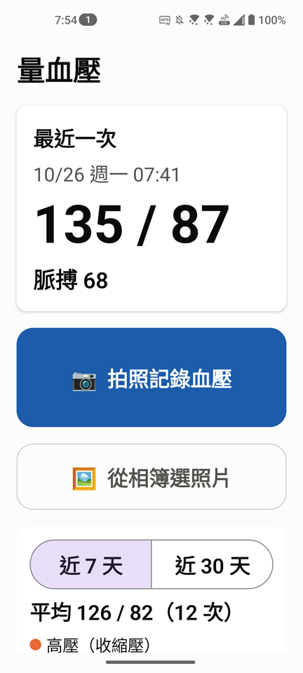
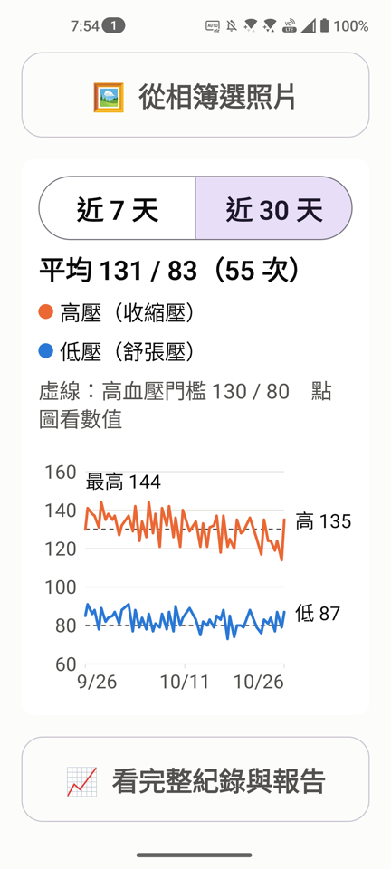
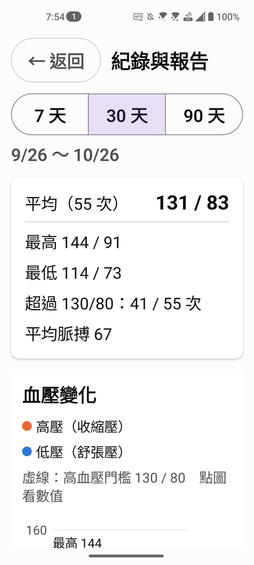
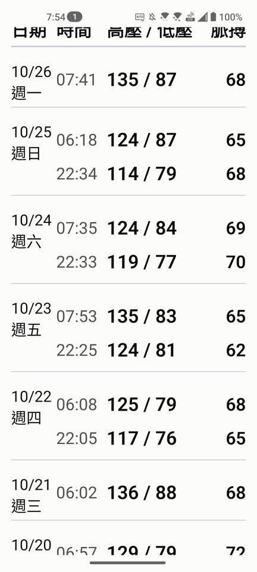

# 量血壓 · Blood Pressure Camera

拍一張血壓計螢幕的照片，App 會**完全離線**讀出收縮壓 / 舒張壓 / 脈搏、記下拍照時間並存檔，
再用趨勢圖與每日血壓表呈現，方便長期觀察、回診時直接給醫師看。
介面為長輩設計：大字、大按鈕、每個畫面只做一件事。

*Snap a photo of a blood-pressure monitor; the app reads systolic / diastolic / pulse fully offline
with a custom seven-segment decoder, timestamps and stores it, and charts the trend. Native Android,
Kotlin + Jetpack Compose, large-type UI for older users.*

<p>
  
  
  
  
</p>

<sub>截圖為示範版的假資料。</sub>

## 下載安裝

到 [Releases](../../releases/latest) 下載 `blood-pressure-*.apk`，用手機開啟安裝。
第一次安裝時 Android 會詢問是否允許「安裝未知來源的應用程式」，允許即可。

- 需求：Android 8.0 以上、有後鏡頭
- 權限：只有相機。App **沒有網路權限**，照片與紀錄只存在手機裡

> ⚠️ 辨識目前是針對**綠色背光、七段數字**的上臂式血壓計調校（開發時使用「娇之乐」電子血壓計）。
> 其他款式（例如灰色無背光螢幕）可能讀不到。
>
> 這不是醫療器材，數值請以血壓計本身為準，用藥請遵照醫師指示。

## 功能

- **拍照即辨識**：按下快門立刻分析，讀到就自動存檔；讀不到會請你重拍並給拍照訣竅
- **時間以拍照當下為準**（UTC+8），不採用血壓計上未校正的時鐘；從相簿匯入時用照片的拍攝時間
- **趨勢圖**：首頁看近 7 / 30 天，高壓、低壓兩條線，標出最新值與期間最高點，點圖看當次數值
- **紀錄與報告**：7 / 30 / 90 天的平均、最高、最低、超過 130/80 的次數、平均脈搏，以及每日血壓表
- 每筆都保存原始照片，讀錯時可對照照片修改

## 辨識怎麼做

一般 OCR（包含 Google ML Kit）幾乎讀不到七段顯示器的數字：筆畫之間是斷開的，不被當成文字。
所以這裡自己寫了一個解碼器 [`SevenSegmentReader`](app/src/main/java/tw/fann/bp/ocr/SevenSegmentReader.kt)，純 Kotlin、不依賴 Android：

1. 找出照片中最大的綠色背光區域（螢幕），用 PCA 算出傾斜角並轉正
2. 從原解析度裁切、統一縮放到固定高度，讓後續參數與拍攝距離無關
3. 自適應二值化，填滿反光造成的空心筆畫，只留下細長的筆畫形狀（濾掉圖示與小字）
4. 自動修正斜體，切成一列列、一格格數字，檢查 7 段筆畫哪幾段亮；允許錯一段（但最接近的數字必須唯一）
5. 用 6 組二值化參數各讀一次，收縮壓 / 舒張壓 / 脈搏各自多數決

## 開發

```bash
./gradlew :app:assembleDebug          # 開發版
./gradlew :app:testDemoUnitTest       # JVM 測試：解碼、分級、報告統計、時區
./gradlew :app:connectedDemoAndroidTest   # 真機端到端驗收（需接手機）
```

- **驗收測試**（[AcceptanceTest](app/src/androidTest/java/tw/fann/bp/AcceptanceTest.kt)）走真實路徑：
  真實血壓計照片 → 載入 → 解碼 → 寫入 SQLite → **從資料庫讀回**比對人工判讀的黃金值。
  測試用照片已移除 GPS 等中繼資料，只保留旋轉方向與拍攝時間。
- **`demo` build type**：另一個 App「量血壓(示範)」（`tw.fann.bp.demo`），第一次開啟會填入 30 天假資料；
  驗收測試也跑在這裡，不會碰到正式版的紀錄。
- **正式版簽章**：在 `~/.gradle/gradle.properties` 設定 `BP_KEYSTORE_FILE`、`BP_KEYSTORE_PASSWORD`、
  `BP_KEY_ALIAS`、`BP_KEY_PASSWORD` 後執行 `./gradlew :app:assembleRelease`。

技術：Kotlin · Jetpack Compose · CameraX · SQLite · JUnit · AndroidX Test
